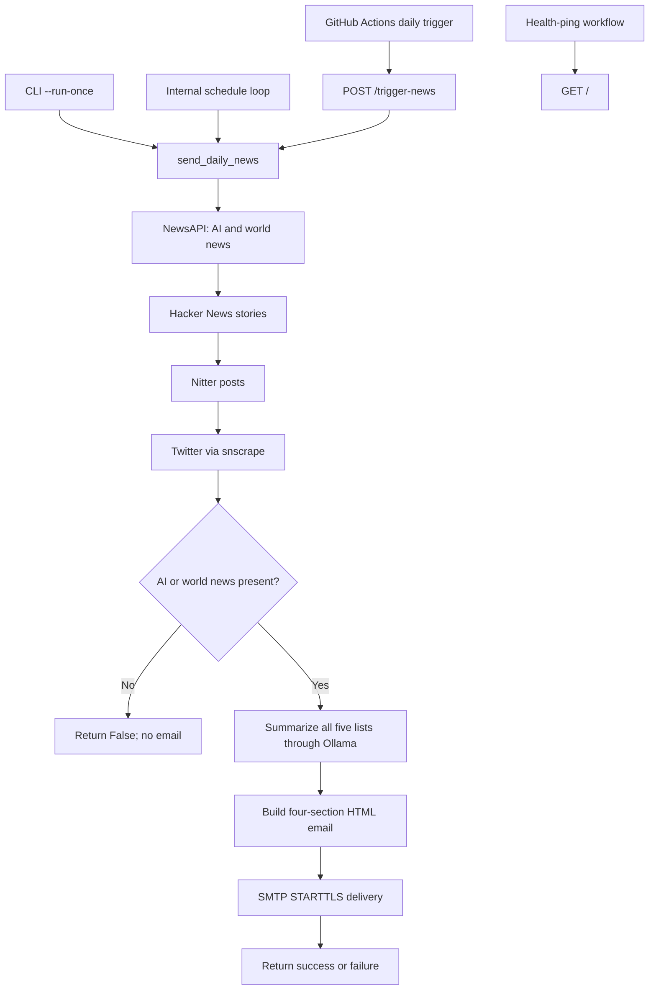

# Daily AI & World News — Complete Project Documentation and Analysis

## Current delivery target: 3:00 PM Pakistan time

The daily target has been changed from 12:15 PM to **3:00 PM Asia/Karachi** (10:00 UTC). Frequent checks, same-day recovery and the per-day delivery ledger remain enabled. The October 21 timed test described below actually ran at 11:40 AM and remains historical evidence; it does not describe the new target. The external cron-job.org job `8692525` is now enabled for daily preparation at **2:40 PM Asia/Karachi**, using a restricted Actions token. [PR #7](https://github.com/Talha-hub-wq/daily-ai-news/pull/7) deploys the 3:00 PM target; Render also serves that revision.


The external clock was verified on October 21: cron-job.org called GitHub at **2:51:04 PM Pakistan time** and received HTTP **204**. [The resulting production run](https://github.com/Talha-hub-wq/daily-ai-news/actions/runs/39580143229) started at **2:51:07 PM** with the 3:00 PM timing gate. The normal daily **2:40 PM** schedule was restored and read back; its next execution is **October 22 at 2:40 PM**. This confirms scheduler-to-workflow delivery; inbox receipt remains a separate check.

## October 21 correction ? 11:40 AM Pakistan test

The October 19?20 scheduled runs started more than three hours late. Their logs show that the previous one-hour delivery cutoff rejected them before collecting news or sending mail. That cutoff was removed. At that stage the target was **11:40 AM Asia/Karachi** (06:40 UTC), with frequent checks every 15 minutes instead of a single daily trigger. Delayed checks catch up on the same local day; the daily cached delivery ledger prevents ordinary repeated submissions. Preparation failures before SMTP can be retried by the next check. If SMTP acceptance is uncertain, the saved `submitting` record blocks blind retries and requires inbox/log inspection. Cache loss or a runner crash before persistence remains a limitation; SMTP does not provide an atomic exactly-once transaction with Actions cache.

The workflow's `scheduled` manual-dispatch input exercises the same 11:40 timing gate. No OpenAI provider or paid service is introduced. GitHub cron itself still has no exact-time guarantee; a persistent/reliable external scheduler would be needed for a stronger timing commitment. Earlier 10 PM/one-hour-cutoff descriptions below are historical and superseded by this correction.


**Review date:** October 6, 2026 (Asia/Karachi)
**Active branch:** `ollama-with-AI-News-Agent`
**Project root:** `D:\daily AI news`
**Scope:** Current application source, configuration, email template, deployment files, both existing workflows, all 17 existing Markdown documents, environment variable names, local Python environments, Git tracking status, and a sanitized aggregate review of the existing log.

This document consolidates the project into one reference. Implementation details come from the current working tree, including uncommitted changes. Older guides describe earlier versions and sometimes contradict the code. External hosting facts are linked to official documentation where verified. Credential values are intentionally excluded.

## October 19 delivery-timing correction

The live default branch remained on the old Render-trigger workflow because PR #1 was unmerged. Daily runs from October 7?17 failed; the October 18 success ended at 21:43:56 Pakistan time, matching the supplied screenshot. This is evidence of missed runs, not proof of several days of mail-server delay.

With explicit approval, encrypted Actions secrets were configured, duplicate keep-alive schedules disabled, and [a real cloud pipeline/email test passed](https://github.com/Talha-hub-wq/daily-ai-news/actions/runs/39234426654). The corrected workflow prepares at `45 16 * * *` (21:45 PKT); `app/delivery_time.py` holds scheduled SMTP delivery until 22:00 and refuses sending after 23:00. Manual tests bypass the wait. New dated subjects, timezone-aware Date headers, unique Message-IDs and generation timestamps identify each actual Pakistan-day digest. Unrendered Twitter work was removed from the sending path. Render health now identifies the external scheduler and deployed commit instead of claiming an internal timer is active. These facts supersede earlier pending-approval/schedule descriptions below.

## Live deployment progress ? October 7

Repository unarchived and feature branch published at `f32ceff`. [Draft PR #1](https://github.com/Talha-hub-wq/daily-ai-news/pull/1) awaits cloud validation before merge. No Actions secrets are configured. Automatic approval review requires explicit approval for credential transfer, old-workflow disabling and one real email test. Render connection/redeployment is pending. Earlier archived-state findings below describe the state before these actions.

## Current free-tier deployment decision

The user confirmed that hosting must stay free and their PC will be off. This supersedes the paid Cron proposal in the earlier review below. The current [deployment guide](RENDER_REDEPLOYMENT_GUIDE.md) describes the selected setup:

- GitHub Actions runs the complete news/Ollama/SMTP pipeline on a standard Ubuntu cloud runner at `0 17 * * *` (10 PM Pakistan time, subject to GitHub delay).
- The cloud runner installs Ollama and pulls `qwen3:1.7b`; local settings retain `qwen3:8b`. `CLOUD_LLM_MODEL` may override the cloud model. Real cloud performance and delivery remain unverified.
- GitHub Actions secrets provide NewsAPI and SMTP credentials. No PC endpoint, paid model API or Render email trigger is used.
- `render.yaml` now defines a `plan: free` web/status service, not a paid Cron Job. Render sleep and blocked SMTP do not affect the separate GitHub email job.
- Scheduled sends default to enabled; `DAILY_NEWS_SCHEDULER=disabled` pauses them. The workflow must reach the default branch to run on its daily schedule.
- Repository archiving still blocks publication. Account access, private Actions secrets, a manual email test and Render redeployment remain necessary.

## October 7 deployment update

The sections below retain the October 6 review context. For current Render setup, use [RENDER_REDEPLOYMENT_GUIDE.md](RENDER_REDEPLOYMENT_GUIDE.md) and [README.md](README.md); this update supersedes older scheduling, authentication and failure-status findings in this report.

- Deployment changes were committed locally, but GitHub rejected the feature-branch push because the repository is archived/read-only. Unarchiving is required before publication.
- Existing public Render web service responded after waking, advertising the old `13:25` server-local schedule. Recent available daily GitHub runs were failures in June; successful ongoing email delivery has not been verified.
- Prepared Render Cron `daily-ai-news-digest` uses `0 17 * * *` (10 PM Pakistan time), the feature branch and paid plan `0.5c-512mb`. It requires a separately hosted, reachable Ollama server.
- Internal scheduling defaults to `22:00` / `Asia/Karachi`, with explicit timezone validation and the pytz dependency.
- Ollama model readiness is checked before collecting news. Optional `LLM_API_TOKEN` supports a gateway bearer token. CLI `--check-services` checks that connection without email; failed `--run-once` exits with status 1.
- `/trigger-news` and `/logs` now require a private bearer `TRIGGER_TOKEN`; blank configuration disables access. SMTP connections have a 30-second timeout.
- The updated GitHub delivery workflow uses 17:00 UTC, validates health and delivery responses, requires URL/token configuration, and gates scheduled runs on `DAILY_NEWS_SCHEDULER=github`. The remaining keep-alive workflow is manual only. Default-branch workflows still require publication or dashboard disabling to change the existing remote behavior.
- New tests verify timezone conversion, protected routes, readiness, preflight failure, and CLI exit behavior. No new Render service or end-to-end mail delivery has been completed by these edits.

## Contents

1. [Purpose and current status](#1-purpose-and-current-status)
2. [Repository inventory](#2-repository-inventory)
3. [Architecture and execution flow](#3-architecture-and-execution-flow)
4. [Module reference](#4-module-reference)
5. [News sources and data formats](#5-news-sources-and-data-formats)
6. [Configuration and secrets](#6-configuration-and-secrets)
7. [Dependencies and Python environments](#7-dependencies-and-python-environments)
8. [Local setup and operation](#8-local-setup-and-operation)
9. [HTTP API](#9-http-api)
10. [Scheduling and time zones](#10-scheduling-and-time-zones)
11. [Deployment and automation](#11-deployment-and-automation)
12. [Email format](#12-email-format)
13. [Logging, failure handling, and troubleshooting](#13-logging-failure-handling-and-troubleshooting)
14. [Findings and priorities](#14-findings-and-priorities)
15. [Documentation reconciliation and index](#15-documentation-reconciliation-and-index)
16. [Customization and future work](#16-customization-and-future-work)
17. [Validation and review limits](#17-validation-and-review-limits)

## 1. Purpose and current status

The project collects AI/world news and supplementary tech/social stories, summarizes them locally through Ollama, and sends an HTML digest. It supports one-shot execution, an internal daily scheduler, and HTTP triggering.

The active model is **qwen3:8b**, already installed on this computer. The migration removes the OpenAI SDK dependency, cloud completion call, and API-key requirement. The app uses Ollama's native HTTP API with no cloud-provider fallback.

Implemented features include up to five AI/world articles each, Hacker News/Nitter sections, optional Twitter collection, local summaries with text fallback, configurable model/server/generation settings, SMTP delivery, Flask routes, scheduling, and GitHub workflows. The separate Twitter list is still not rendered in the email.

Local inference has passed a real summary check, and offline provider/configuration/pipeline tests are provided. Full live news/email delivery and cloud deployment remain unverified. Remaining issues include public routes, no durable duplicate prevention, synchronous network work, scraper fragility, and inconsistent schedule settings.

Despite the Agent name, this is a sequential pipeline, not an autonomous agent framework. `Agent.py` is now a placeholder pointing to the provider. Earlier guides are retained as historical references with migration notices.

## 2. Repository inventory

### Application and supporting files

| Path | Responsibility / status |
|---|---|
| [app/main.py](app/main.py) | Application orchestration, logging setup, Flask routes, CLI handling, scheduler thread |
| [app/news_fetcher.py](app/news_fetcher.py) | NewsAPI requests, AI/world queries, title deduplication |
| [app/llm_provider.py](app/llm_provider.py) | Native Ollama HTTP client and configured factory |
| [app/summarizer.py](app/summarizer.py) | Local summaries and source-text fallbacks |
| [app/email_sender.py](app/email_sender.py) | HTML assembly, MIME message construction, SMTP send |
| [app/scheduler.py](app/scheduler.py) | Daily/interval scheduling and polling loop |
| [app/hackernews_scraper.py](app/hackernews_scraper.py) | Hacker News Firebase API and keyword filter |
| [app/nitter_scraper.py](app/nitter_scraper.py) | Nitter instance probing and regex-based post extraction |
| [app/twitter_scraper.py](app/twitter_scraper.py) | `snscrape` search and popularity/language filters |
| [app/google_search.py](app/google_search.py) | Entire implementation commented out; no callable `google_search` |
| [app/Agent.py](app/Agent.py) | Provider documentation placeholder; no executable definitions |
| [config/settings.py](config/settings.py) | `.env` loading, defaults, constants, required-value validation |
| [templates/email_template.html](templates/email_template.html) | HTML layout with four substitution placeholders |
| [test_google.py](test_google.py) | Manual Google Search script; currently imports an undefined function |
| [requirements.txt](requirements.txt) | Five pinned dependencies; no cloud SDK |
| [.env.example](.env.example) | Safe local-provider/news/email template |
| [tests/test_local_llm.py](tests/test_local_llm.py) | Offline provider, summarizer, configuration, and pipeline tests |
| [runtime.txt](runtime.txt) | Declares Python `3.11.8`; actual hosting version must be checked separately |
| [build.sh](build.sh) | Dependency installation, log-directory creation, config validation |
| [Procfile](Procfile) | Release validation and single-worker Gunicorn web command |
| [render.yaml](render.yaml) | Paid cron example with Ollama settings; requires a reachable model server |
| [.github/workflows/daily-news.yml](.github/workflows/daily-news.yml) | Daily/manual HTTP trigger with retries |
| [.github/workflows/keeps-alive.yml](.github/workflows/keeps-alive.yml) | Scheduled/manual health ping |
| [.gitignore](.gitignore) | Excludes `.env`, logs, common Python artifacts, `venv/`, and IDE files |
| `.env` | Local private configuration; exists and is Git-ignored |
| `logs/app.log` | Existing runtime history; ignored, contains sensitive information |
| `.venv/` | Local virtual environment; several interpreter files are already Git-tracked |
| `venv/` | Another local virtual environment; excluded by `.gitignore` |
| `.git/` | Repository metadata; existing version history, not application code |

All existing Markdown files are listed in [section 15](#15-documentation-reconciliation-and-index).

### Missing or absent components

The migration adds `.env.example` and an automated offline test suite. The inventory still has no `LICENSE`, `docs/INDEX.md`, database, migration layer, Dockerfile, settings UI, subscription management, unsubscribe flow, or durable email history. Although `app/` and `config/` have no `__init__.py`, Python namespace-package imports can work with the project root on `sys.path`.

### Git state at review

The repository already contained modified application/settings files and numerous untracked guides. `app/Agent.py`, `app/google_search.py`, and `test_google.py` were also untracked. Two tracked keep-alive files were deleted in the working tree: `.github/keep-alive.yml` and `.github/workflows/keep-alive.yml`. The existing `keeps-alive.yml` workflow remains present. These pre-existing changes were preserved.

Several `.venv/Scripts/` executables and `.venv/pyvenv.cfg` are tracked. `.gitignore` does not explicitly exclude `.venv/`. A future cleanup should remove environment artifacts from tracking and add the missing ignore rule; adding an ignore rule alone will not untrack existing files.

## 3. Architecture and execution flow



All sources are fetched sequentially. Summaries are also generated sequentially, one eligible item at a time. There is no parallel fetching, persistent cache, job queue, or database.

### `send_daily_news()` sequence

1. Log the start of a run.
2. Create `NewsFetcher(NEWSAPI_KEY)` and fetch AI and world news.
3. Fetch Hacker News stories with limit five.
4. Fetch Nitter posts for `AI tools OR machine learning`, limit five.
5. Fetch Twitter posts for `AI OR ChatGPT OR OpenAI lang:en min_faves:50`, limit five.
6. Return `False` if both AI and world lists are empty, even if supplementary sources returned items.
7. Create `NewsSummarizer()` with the configured local provider and summarize all five lists.
8. Create `EmailSender` and resolve the template relative to the source directory.
9. Send AI, world, Hacker News, and Nitter data. The Twitter argument is commented out, and `EmailSender` has no Twitter parameter.
10. Return `True` on successful SMTP submission, otherwise `False`; an outer exception handler logs failures.

At most 25 collected items are passed to the summarizer and at most 20 appear in the email. Empty sources reduce these counts. A send requires at least one AI or world article.

### Startup behavior

On importing `app/main.py`, the project root is added to `sys.path`, `logs/` is created relative to the current working directory, logging handlers are configured, imports are resolved, and the Flask app/routes are defined.

On running the file directly, `main()` validates configuration. With `--run-once`, it runs the job and returns. Otherwise, it starts a daemon scheduler thread and Flask's built-in server on `0.0.0.0`, using `PORT` or `5000`.

The current parser only recognizes `--run-once`. There is no active `--help` handler; passing it starts the service after validation.

## 4. Module reference

### `app/main.py`

| Function | Behavior |
|---|---|
| `send_daily_news()` | Fetch, summarize, render, and send; returns Boolean |
| `start_scheduler()` | Registers daily job and runs the scheduler; logs scheduler exceptions |
| `health_check()` | Returns a static healthy response and schedule string |
| `trigger_news_endpoint()` | Runs the entire job synchronously; returns HTTP 200/500 |
| `get_logs()` | Reads the log file and returns the last 50 lines |
| `main()` | Validates settings and chooses one-shot or continuous mode |

The obsolete commented main implementation was removed during migration. Disabled Google-search sketches remain outside the active pipeline.

### `app/news_fetcher.py` — `NewsFetcher`

- Constructor stores the API key, NewsAPI `/v2/everything` URL, and ten-second request timeout.
- `fetch_ai_news()` tries four queries in order, stops when the raw collected count reaches five, then deduplicates and takes the first five.
- `fetch_world_news()` runs one query, deduplicates, and takes five.
- `_fetch_from_newsapi()` supplies English language, publication-date sorting, a date seven days before server-local “now,” and page size ten.
- Articles must have a title and URL to be retained.
- `_deduplicate_articles()` compares stripped lowercase titles, preserving first occurrence and order.
- Request/JSON failures produce logged errors and empty lists.

The early stop precedes deduplication, so five raw matches can yield fewer than five unique results without trying additional queries. Deduplication occurs independently within each category; it does not prevent the same story across categories, sources, runs, or days.

### `app/llm_provider.py` - `OllamaProvider`

`create_llm_provider()` validates settings and builds the supported Ollama client. It posts to `{LLM_BASE_URL}/api/chat` with the model, `stream=false`, `think=false`, a two-sentence summarization prompt, `options.num_predict`, and `options.temperature`. Requests use the configured timeout. The response must contain nonblank string `message.content`; HTTP/error/malformed/empty responses raise exceptions. [Ollama chat API](https://docs.ollama.com/api/chat).

### `app/summarizer.py` - `NewsSummarizer`

The summarizer uses its configured provider or an injected test provider. It selects content before description before title, normalizes null fields, and skips inference for text shorter than 20 characters. Eligible items run sequentially. Inference failures log only the exception type and fall back to the first 150 characters of source text. Dictionaries retain their fields and receive `summary`.

The pipeline still does not fetch full article bodies. NewsAPI provides snippets; social posts now use real post content rather than like metadata. Hacker News normally supplies only its title as content. Output format/factuality is guided by the prompt, not guaranteed.

### `app/email_sender.py` — `EmailSender`

- Constructor stores sender, password, SMTP server, and port.
- `send_news_email()` normalizes omitted supplementary lists to empty lists, reads the UTF-8 template, builds HTML, creates MIME headers/body, sends, and returns a Boolean.
- `_build_html_content()` assembles per-item HTML and uses literal string replacement for four placeholders.
- `_send_smtp()` creates an SMTP connection, requests STARTTLS, logs in, and calls `sendmail()`.

There is no explicit SMTP timeout, retry loop, OAuth authentication, plain-text MIME alternative, or escaping of external text/URLs. SMTP acceptance is not proof of inbox delivery. Recipient input is passed as one string; there is no implemented multi-recipient list handling.

### `app/scheduler.py` — `NewsScheduler`

- `schedule_daily(time_str, job_func)` registers `schedule.every().day.at(time_str)`.
- `schedule_every_hours(hours, job_func)` registers an hourly interval.
- `start()` runs pending jobs and sleeps 60 seconds between checks.
- `run_once()` actually invokes `schedule.run_all()`, running all registered jobs, not just pending jobs as its docstring suggests.
- `scheduled_jobs` is initialized but never populated or used.

It uses the `schedule` library's global registry and runs jobs in the polling thread. Registrations are lost on process exit. A long job delays later checks. A loop exception can end scheduling while the Flask service continues to respond.

### Supplementary modules

- **Hacker News:** Fetches top-story IDs, then each item until five matching stories are found. Timeouts are ten seconds for IDs and five seconds per item. Filters `type == "story"` and title substrings: `ai`, `artificial intelligence`, `machine learning`, `llm`, `openai`, `chatgpt`, `tech`, `startup`. It does not bound the number of IDs inspected or call `raise_for_status()`; `ai` can match unrelated words.
- **Nitter:** Probes four hardcoded instances for HTTP 200, then fetches the selected search page again. Probe timeout is ten seconds, final fetch timeout 15 seconds. Extracts posts with a specific regex, removes HTML tags, and rejects text shorter than 20 characters. `TweetParser` only initializes state and is unused. Public instances and markup are fragile; current availability was not tested.
- **Twitter:** Imports `snscrape.modules.twitter` inside the optional collector; missing imports return an empty list with a warning. Iterates search results until five accepted posts; requires English, likes greater than 50, no reply, and no retweet. It has no application-level iteration cap or timeout. Per-item and outer errors are caught only after import succeeds.
- **Google Search:** Commented code sketches a Google Custom Search API integration using `GOOGLE_API_KEY` and `GOOGLE_CSE_ID`, but neither settings nor callable implementation is active. Main's Google calls are also commented out.
- **Agent placeholder:** `Agent.py` points to the current local-provider module and has no runtime role; old cloud-client sketches were removed.
- **Google test script:** Runs statements at module import and attempts to import the inactive Google function. It is not an automated assertion-based test.

## 5. News sources and data formats

### Source configuration

| Source | Query / endpoint | Limit | Included in email? |
|---|---|---:|---|
| NewsAPI AI | Four ordered queries below | 5 | Yes |
| NewsAPI world | `top world news today` | 5 | Yes |
| Hacker News | Firebase `topstories.json` and `item/{id}.json` | 5 | Yes |
| Nitter | `AI tools OR machine learning` | 5 | Yes |
| Twitter / snscrape | `AI OR ChatGPT OR OpenAI lang:en min_faves:50` | 5 | No |
| Google Custom Search | Disabled experimental integration | — | No |

AI queries, in order:

```text
latest AI news 2026
new AI tools released
AI advancements breakthrough
artificial intelligence products
```

The first query hardcodes the year 2026. Searches are date-sorted matches, not a separate editorial quality or importance ranking. “Top five” in the UI means the first five retained results, not a verified global top-five list.

Nitter instance list:

```text
https://nitter.net
https://nitter.1d4.us
https://nitter.esmailelbob.xyz
https://nitter.privacydev.net
```

### Dictionary schemas

There are no typed models or schema validation; each source returns a list of dictionaries.

| Field | NewsAPI | Hacker News | Nitter | Twitter |
|---|---|---|---|---|
| `title` | Article title | Story title | First 80 characters | First 80 characters plus ellipsis |
| `description` | API description, possibly null | Points and comment-count text | Absent | Like-count text |
| `content` | Absent | Story title | Cleaned post text | Full post text |
| `url` | Article URL | External story URL or HN discussion fallback | Twitter URL for relative links | Constructed Twitter status URL |
| `source` | Source name | Absent | Absent | Absent |
| `image` | API image URL | Absent | Absent | Absent |
| `published_at` | API publication timestamp | Absent | Absent | Absent |
| `category` | `AI news` or `world news` | Absent | Absent | Absent |
| `author` | Absent | Username | Parsed username or `Unknown` | Username |
| `points` | Absent | Score | Absent | Absent |
| `likes` | Absent | Absent | Always zero | Like count |
| `summary` | Added during summarization | Added | Added | Added but not rendered |

NewsAPI images and publication dates are stored but not displayed. Hacker News comment counts are embedded in `description`, not returned as a separate field by the active implementation.

## 6. Configuration and secrets

Settings load the project-root `.env` by an absolute source-relative path. They are read at import, so restart after changes. Exported process variables take precedence over dotenv values.

| Variable | Default | Use / validation |
|---|---|---|
| `LLM_PROVIDER` | `ollama` | Only supported provider |
| `LLM_BASE_URL` | `http://127.0.0.1:11434` | HTTP(S) server URL, no credentials/query/fragment |
| `LLM_MODEL` | `qwen3:8b` | Nonempty installed model name |
| `LLM_TIMEOUT` | `120` | Positive finite seconds, used by requests |
| `LLM_MAX_TOKENS` | `160` | Positive output budget, passed as `num_predict` |
| `LLM_TEMPERATURE` | `0.3` | Finite value between 0 and 2 |
| `NEWSAPI_KEY` | Empty | Required active news credential |
| `EMAIL_SENDER` | Empty | Required sender/login |
| `EMAIL_PASSWORD` | Empty | Required SMTP password |
| `EMAIL_RECIPIENT` | Empty | Required recipient |
| `SMTP_SERVER` | `smtp.gmail.com` | SMTP host |
| `SMTP_PORT` | `587` | Parsed integer |
| `SCHEDULE_TIME` | `15:23` | Server-local internal daily time |
| `PORT` | `5000` | Direct Flask server port |

`validate_llm_config()` checks inference settings independently. `validate_config()` also checks required nonblank NewsAPI/email fields. Neither proves remote access, installed models, SMTP login, or schedule syntax. Invalid numeric strings may fail at import.

The migration removes `OPENAI_API_KEY` and the unused `SUMMARIZER_MODEL` from active config and `.env`, adds six local settings, and preserves private news/email/SMTP/schedule values. No secret values are included here.

[.env.example](.env.example) now contains safe defaults and blank credential placeholders. Its `SCHEDULE_TIME=22:00` is an example, not the actual private schedule. See README for the full configuration example.

Unused constants `NEWS_LIMIT=5`, `MAX_RETRIES=3`, and `RETRY_DELAY=5` remain; they do not control collector literals or request retries. Local model and generation settings are wired into the provider.

## 7. Dependencies and Python environments

| Package | Pin | Role |
|---|---|---|
| requests | 2.31.0 | Source and Ollama HTTP calls |
| schedule | 1.2.0 | Scheduler |
| python-dotenv | 1.0.0 | Environment loading |
| flask | 3.0.3 | HTTP app |
| gunicorn | 22.0.0 | Linux hosting |

No OpenAI/Ollama SDK is required. `snscrape` is an optional extra, not in the manifest; missing it skips Twitter and no longer prevents startup.

`runtime.txt` declares Python 3.11.8; available Python reports 3.11.9. Before migration, `.venv` had no project dependencies, while `venv` had requests 2.31.0, schedule 1.2.0, python-dotenv 1.0.0, Flask 2.3.0, and no Gunicorn/snscrape. Default Python also differs from requirements. Old SDK packages may remain installed but are no longer used by this project.

Current verification uses `venv/Scripts/python.exe`. Flask in `venv` was upgraded from 2.3.0 to the pinned 3.0.3 after an existing Werkzeug/test-client mismatch was detected. A full clean dependency installation was not performed. Synchronize packages in one explicit environment before deployment; use direct Python for Windows and Gunicorn for Linux hosting.

## 8. Local setup and operation

### Prerequisites

- A Python environment with the application's compatible dependencies.
- Working NewsAPI credentials, a running Ollama server, and the configured installed model.
- An SMTP account compatible with username/password authentication and STARTTLS.
- Internet access to source services and the SMTP host.
- A configured recipient and permission to send to that address.

The original guides use Gmail app passwords and describe other SMTP hosts. Verify the selected provider's current account authentication requirements; this review did not validate any provider account.

### Setup commands for Windows PowerShell

Run from the project root. Start Ollama and select an installed model. Missing optional Twitter dependencies no longer block startup.

```powershell
Set-Location 'D:\daily AI news'
python -m venv .venv
.\.venv\Scripts\python.exe -m pip install -r requirements.txt
```

The first command creates or reuses `.venv`; an existing environment is already present in this checkout. Using its interpreter explicitly avoids ambiguity between the two virtual environments and global Python. Configure `.env` privately with the variables above; do not overwrite an existing populated file with placeholders.

### Modes

| Command | Result / side effect |
|---|---|
| `.\.venv\Scripts\python.exe app/main.py --run-once` | Fetches data, uses paid API access where applicable, and attempts a real email send |
| `.\.venv\Scripts\python.exe app/main.py` | Starts internal scheduler and Flask server; scheduled jobs send real email |
| `python -c "from config.settings import validate_config; validate_config()"` | Checks required nonempty settings only, using the selected default interpreter |

For a shell with the intended environment activated, equivalent project commands are `python app/main.py` and `python app/main.py --run-once`.

One-shot mode currently ignores `send_daily_news()`'s return value. A failed job can therefore finish with process exit code zero. Read the job logs and verify receipt; a successful process exit is not sufficient evidence of a send.

### Local HTTP inspection

With the service running:

```powershell
Invoke-RestMethod -Uri 'http://127.0.0.1:5000/' -Method Get
Invoke-RestMethod -Uri 'http://127.0.0.1:5000/logs' -Method Get
```

An intentional delivery can be triggered with:

```powershell
Invoke-RestMethod -Uri 'http://127.0.0.1:5000/trigger-news' -Method Post
```

The POST runs the real pipeline. There is no dry-run, preview, or “fetch only” CLI flag.

### Operating-system scheduling

The guides also describe Windows Task Scheduler or system cron running `app/main.py --run-once`. Use the intended interpreter's absolute path and set the working directory to the project root. In this mode, the operating system's schedule decides when to run; `SCHEDULE_TIME` does not schedule the one-shot invocation.

## 9. HTTP API

No route requires authentication. No request body is needed, and there is no rate limiting or idempotency key.

| Method | Route | Behavior | Response |
|---|---|---|---|
| GET | `/` | Process liveness response | 200 JSON |
| POST | `/trigger-news` | Synchronous fetch, summary, and email | 200 on `True`, 500 on `False` or exception |
| GET | `/logs` | Last 50 log-file lines | 200; 404 if missing; 500 on read error |

### Current response shapes

Health response, assuming the default schedule:

```json
{
  "status": "healthy",
  "service": "Daily AI News Automation",
  "next_run": "Daily at 15:23 (server local time)"
}
```

It does not check credentials, source availability, SMTP, scheduler-thread health, or previous job success. Under Gunicorn, it still advertises an internal schedule even though that scheduler is not started.

Trigger success:

```json
{"status": "success"}
```

Trigger failure:

```json
{"status": "error"}
```

The endpoint's outer exception handler can also include a `message` field. Most job exceptions are already caught by `send_daily_news()`, so those normally result in the simple error object.

Logs response:

```json
{"logs": ["a log line\n", "another log line\n"]}
```

The implementation reads the whole file before taking its last 50 lines. This is a public log disclosure route if deployed unchanged, and it becomes less efficient as the file grows.

## 10. Scheduling and time zones

There are three independent delivery schedulers. Changing one does not change the others.

| Mechanism | Current configuration | Pakistan-time interpretation |
|---|---|---|
| Internal Python scheduler | `SCHEDULE_TIME`, default `15:23` | 3:23 PM if server-local time is Pakistan; 8:23 PM if server-local time is UTC |
| Daily GitHub workflow | `25 13 * * *`, no timezone field | 6:25 PM Pakistan time |
| Render cron Blueprint | `0 22 * * *` | 3:00 AM Pakistan time on the following day |
| Email footer | Fixed text “10:00 PM daily” | No timezone; not derived from runtime schedule |
| Health-ping workflow | `* * * * *` | Requests every minute by expression; unsupported interval for GitHub scheduled workflows |

The daily workflow comment correctly converts 13:25 UTC to 18:25 Pakistan time. The settings comment incorrectly labels `15:23` as 10 PM. Many guides describe 22:00 UTC, which differs from the actual daily workflow.

### Correct conversions for common intentions

Pakistan time is UTC+05:00:

| Desired Pakistan time | UTC time | UTC cron expression |
|---|---|---|
| 10:00 PM same day | 17:00 | `0 17 * * *` |
| 6:25 PM same day | 13:25 | `25 13 * * *` |
| 3:00 AM next day relative to a 22:00 UTC run | 22:00 previous UTC day | `0 22 * * *` |

Choose one delivery scheduler. Starting the internal scheduler with `python app/main.py` while also enabling GitHub's POST trigger can produce two independent daily sends. One-shot cron does not start the internal scheduler.

The internal scheduler only operates while its process is alive. It has no durable record of missed sends and no application-level catch-up policy after restarts.

GitHub's official documentation specifies a minimum five-minute interval, default-branch scheduling, possible delays or dropped jobs during load, and automatic disabling of scheduled workflows in public repositories after 60 days without repository activity. The one-minute keep-alive expression cannot be relied upon as supported scheduling. [GitHub scheduled workflow documentation](https://docs.github.com/en/actions/reference/workflows-and-actions/events-that-trigger-workflows#schedule).

## 11. Deployment and automation

### Available execution patterns

| Pattern | Startup | Delivery scheduling | Current caveat |
|---|---|---|---|
| Local continuous process | `python app/main.py` | Internal scheduler | Must remain running; also exposes routes |
| System or hosting cron | `python app/main.py --run-once` | External scheduler | Job failure is not propagated as nonzero exit |
| Linux web service with Procfile | Gunicorn `app.main:app` | GitHub or another HTTP scheduler | Internal scheduler/`main()` validation does not run |
| Web service using guide's direct command | `python app/main.py` | Internal scheduler plus any external trigger | Built-in Flask server and duplicate-scheduling risk |

### `Procfile`

```procfile
release: python -c "from config.settings import validate_config; validate_config()"
web: gunicorn -w 1 -b 0.0.0.0:$PORT 'app.main:app'
```

Gunicorn imports the Flask application rather than executing `main()`. Therefore it does not start the internal scheduler or call `main()`'s configuration validation. The separate release command only validates configuration if the hosting platform actually executes that process type. Configure build and start commands explicitly on the target platform.

The command has one worker and no explicit worker timeout override. The trigger holds the request while network work runs; long source scans or API delays may exceed server/proxy request budgets. Adding workers would not provide duplicate prevention.

### `build.sh`

The script upgrades pip, installs requirements, creates `logs/`, and validates required configuration. It contains no `set -e`, so a failed earlier command can be followed by its final “Build completed successfully” echo. `render.yaml` and web-service guides use direct pip installation instead, so this script is not automatically part of every deployment path.

### Current `render.yaml`

The Blueprint is now a paid cron example using `runtime: python` and `plan: starter`, with all six local inference variables. Secret fields and the server URL use `sync: false`. The one-shot command and `0 22 * * *` UTC schedule remain.

It does not install Ollama/model files or deploy the model. A cloud process cannot reach Ollama on your PC through localhost: that address refers to the cloud machine. Provide an appropriately secured reachable server or run inference beside the app. Loopback works directly when both run on your computer.

The file has not been submitted to hosting validation or deployed. Configuration follows the [Render Blueprint reference](https://render.com/docs/blueprint-spec). Total local inference duration must fit worker/proxy/workflow timeouts.

### Critical Render free-tier compatibility

Render's official free-service documentation states that free web services block outbound traffic on ports **25, 465, and 587**. This application uses SMTP on **587** by default. Consequently, the documented free web service plus Gmail SMTP design is incompatible with that restriction. A successful build or GET health check cannot establish email delivery. Free services also sleep after 15 minutes without inbound traffic, take about a minute to wake, and lose local filesystem changes on restart/redeploy/spin-down. [Render free-service limitations](https://render.com/docs/free).

A future deployment must either use an environment that permits the chosen SMTP traffic or implement delivery through an HTTPS email API. There is no HTTPS email backend in the current code.

Render currently documents a **$1 minimum monthly charge per cron service**, with usage-based billing, not the `$10+` minimum asserted by many project guides. Its cron times use UTC. Hosting costs, model usage, account quotas, and email-provider costs must be checked for the chosen setup; the old `$0 forever`, `$0.50/month`, and `$120/year savings` claims are not verified project costs. [Render cron jobs and billing](https://render.com/docs/cronjobs).

### Daily GitHub Actions workflow

[daily-news.yml](.github/workflows/daily-news.yml) supports daily scheduling and `workflow_dispatch` for a manual run.

- Runs on `ubuntu-latest`, with a 15-minute job timeout.
- Checks out with `actions/checkout@v4` and logs UTC time.
- Waits 15 seconds before attempting the endpoint.
- Targets the hardcoded `https://daily-ai-news-merl.onrender.com` URL.
- Attempts POST `/trigger-news` up to three times.
- Uses a 30-second connect timeout and 180-second request timeout.
- Writes body to `response.txt` and checks for HTTP 200.
- Waits 20 seconds after an unsuccessful attempt.
- Exits unsuccessfully after exhausted attempts and prints success/failure logs.

The workflow does not install or execute Python and contains no application test/build checks. It relies on a separately deployed service. The hardcoded URL was found in configuration; its live deployment status was not checked.

The shell's normal failure behavior can cause an unsuccessful `curl` command assignment to terminate a step before the retry branch. Thus three retries are an intended HTTP-error path, not guaranteed handling of every transport failure. Timeouts after SMTP acceptance can also lead to duplicate sends on retries because there is no idempotency mechanism.

### Health-ping workflow

[keeps-alive.yml](.github/workflows/keeps-alive.yml) performs GET `/` against the same hardcoded URL, allows manual dispatch, attempts twice, and uses 30/120-second connect/request timeouts with a five-second retry delay.

Its comments disagree: one says every 30 minutes, another says every minute is the GitHub minimum, and the expression requests every minute. It tests HTTP liveness only. It does not send email or prove that scheduling or delivery works. It should not be treated as a substitute for choosing a reliable scheduling and hosting arrangement.

### Concrete deployment verification targets

- Dependency installation and active imports succeed in a clean target environment.
- Hosting configuration matches one selected mode.
- Runtime secrets are set without committing their values.
- The email transport works on the selected host.
- The selected schedule maps to the desired local time.
- An intentional end-to-end run produces the expected digest and logs.
- A failed job is detectable by the scheduler/monitoring mechanism.
- Repeated triggers cannot accidentally send duplicate digests after idempotency is implemented.

These are verification targets, not completed deployment claims.

## 12. Email format

**Actual subject:** `Daily AI News + Tech Stories + Trending Tweets`.

The template title/header is `Daily AI & World News`. The older documentation often uses that header as the subject, which is no longer accurate.

| Placeholder | Section | Rendered metadata |
|---|---|---|
| `{{ AI_NEWS }}` | Top AI News | Title, summary/description, source, article link |
| `{{ WORLD_NEWS }}` | Top World News | Title, summary/description, source, article link |
| `{{ HACKERNEWS }}` | HackerNews Tech Stories | Title, summary/content, author, points, link |
| `{{ NITTER }}` | Latest on Twitter via Nitter | Title, summary/content, author, post link |

The template has a 700-pixel maximum-width container, gradient header, white body, dividers, and responsive CSS for widths below 600 pixels. Per-item HTML uses inline styles. Some template class styles are not used by those generated item blocks.

Empty categories retain their section heading but get no items or explicit empty-state text. There is no Twitter-specific placeholder. Images and publication dates are not rendered.

The footer claims the recipient subscribed and says emails send at 10 PM daily. There is no subscription registry or unsubscribe mechanism, and the time text is fixed. The section-title color is `#10101010`, an eight-digit hex value with low alpha that may make headings faint in clients that support it. Responsive rendering and CSS support were not visually tested in email clients.

External titles, summaries, author names, and URLs are inserted into HTML without escaping or URL-scheme validation. This can break markup or introduce unwanted HTML. Missing versus null dictionary fields also do not always produce the same fallback output.

## 13. Logging, failure handling, and troubleshooting

### Logging behavior

- Log level: INFO.
- Format: timestamp, logger name, severity, message.
- Destinations: UTF-8 `logs/app.log` and stdout.
- File path is relative to current working directory; template path is source-relative.
- No rotation, retention policy, structured run IDs, delivery history, or metrics.
- `/logs` exposes the final 50 lines, including errors and recipient information.

### Historical evidence

The pre-migration log snapshot had 1,297 lines with date prefixes ranging from April 24 to May 15, 2026. A sanitized aggregate inspection found:

| Message fragment | Occurrences |
|---|---:|
| `Daily news email sent successfully` | 12 |
| `No news found. Email not sent.` | 5 |
| `Twitter scraping error` | 11 |
| `Google Search error` | 21 |
| `Missing required environment variables` | 3 |

Counts describe existing historical messages, not unique independently verified deliveries. Logs from an earlier Google-enabled implementation do not prove that integration is active now.

The log contains credential-bearing query parameters in historical request URLs. Do not publish the raw file or expose it through an unauthenticated route. If those credentials are still valid, rotate them and remove/redact the affected retained logs. This document contains no raw credential values or recipient addresses from the log.

### Failure handling

| Failure | Current behavior |
|---|---|
| Missing validated settings | Startup `ValueError`; `main()` logs fatal error and exits 1 |
| Invalid integer port | Import/startup parsing exception |
| Missing `snscrape` | Optional Twitter collector warns and returns no posts |
| NewsAPI error | Empty source list and logged error |
| Both AI/world lists empty | No email, even if HN/social data exists |
| Supplementary scraper error | Usually empty list and logged error |
| Local inference request/response error | Truncated source fallback; no cloud request |
| Missing template | `send_news_email()` returns `False` |
| SMTP error | Email sender returns `False`; job reports failure |
| Scheduler exception | Logs error; thread/loop may end while HTTP service remains up |
| HTTP-trigger job failure | HTTP 500 |
| One-shot job failure | Can still exit zero because Boolean return is ignored |

The application has graceful fallbacks but no implemented general fetch/summary/SMTP retry loop. The settings retry constants do not provide retries. The GitHub workflow supplies a separate whole-job HTTP retry path.

### Troubleshooting map

| Symptom | Check / action |
|---|---|
| Missing `snscrape` | Optional Twitter is skipped; main app remains importable |
| Package installed but unavailable | Confirm interpreter path; `.venv`, `venv`, and global Python differ |
| Local summaries fall back | Check Ollama URL, model installation, timeout, and logs |
| “Missing required environment variables” | Set the four checked values and also configure NewsAPI |
| No email with HN/social data | Current gate requires at least AI or world news |
| SMTP timeout on Render free tier | Port 587 restriction conflicts with current transport |
| SMTP authentication failure | Check provider-supported authentication and private credentials |
| Job successful but no inbox message | Review SMTP logs, recipient, spam folders; one-shot exit code can mislead |
| HTTP 200 health but no scheduled email | Health is static; check startup mode and scheduler/external workflow |
| Wrong delivery time | Compare server-local schedule, UTC cron, and Pakistan-time conversion |
| Duplicate emails | Multiple schedulers, concurrent manual triggers, or retries after uncertain send |
| Twitter/Nitter empty or slow | Scraper/service fragility, filters, unbounded scans, instance markup |
| Google test fails at import | Google function is entirely commented out |
| Link to `docs/INDEX.md` fails | Referenced directory/file does not exist; use this document's index |

## 14. Findings and priorities

These are proposed changes, not fixes applied by this documentation task.

| Priority | Finding | Evidence | Proposed resolution |
|---|---|---|---|
| Resolved | Missing scraper blocked startup | Optional import now skips unavailable Twitter | Test an extra dependency only if using that source |
| Blocker for documented free hosting | SMTP transport blocked by host | Port 587 in settings and sender; official Render free limits | Compatible host or implemented HTTPS email delivery |
| High | Historical logs contain credential-bearing URLs and are publicly readable through route | Log review; unauthenticated `/logs` | Redact logging, rotate affected valid keys, protect/remove route |
| High | Trigger endpoint is public and can initiate API usage/email sends | No authentication/rate limits in route | Authenticate trigger and add request/run limits |
| Partly resolved | Deployment config drift | Paid cron/Ollama settings added; earlier guides marked historical | Verify actual hosting and model-server access |
| High | Failed one-shot jobs can appear successful | Ignored Boolean result in `main()` | Return a nonzero exit code on job failure |
| High | No duplicate-send prevention | No lock, persisted run key, or history | Add run serialization and durable idempotency |
| High | Long synchronous trigger can exceed request budget | Sequential/unbounded scans, no explicit Gunicorn timeout | Bound work, align timeouts, consider background execution |
| Medium | Multiple inconsistent schedules | Settings/workflows/Blueprint/footer | Choose one schedule authority and derive display text |
| Medium | Invalid keep-alive interval | One-minute expression versus five-minute GitHub minimum | Remove/reconfigure according to intended operations |
| Resolved | NewsAPI validation missing | Required field now checked | Network/account validity remains separate |
| Medium | Wasted Twitter work | Fetch/summarize without email parameter | Integrate output or stop collecting it |
| Resolved | Summary input favored metadata | Actual content now has priority | Add full articles when available |
| Medium | External values inserted directly into HTML | Email string interpolation | Escape text, validate links, handle nulls |
| Partly resolved | Disconnected settings | Local model/timeout/generation settings now consumed | Legacy news-limit/retry constants still unused |
| Medium | HN/Twitter scans have no application bound | Loop until enough matches | Cap scanned items and total run duration |
| Medium | Local environments differ from requirements | Measured package metadata | Use one reproducible environment and verify imports |
| Medium | Tracked `.venv` binaries | Git tracked-file inventory | Untrack artifacts and ignore `.venv/` |
| Partly resolved | Missing template/license and broken docs link | Safe template now added | License and old docs link still unresolved |
| Low | Commented implementations obscure active behavior | Main, summarizer, HN, Twitter, Agent, Google modules | Remove or archive historical sketches |
| Low | Static/faint email text and HTML-only alternative | Template/footer/MIME construction | Dynamic schedule footer, readable colors, plain-text part |

Other reliability gaps include no SMTP timeout, no source success/error metrics, no date in subject, no cross-day deduplication, and no durable scheduler state.

## 15. Documentation reconciliation and index

All **17 original Markdown files** were reviewed. README and this report now describe the local branch; the other 15 guides are prominently marked historical. They collectively explain setup, credentials, GitHub publishing, Render deployment, external triggering, verification, monitoring, troubleshooting, customization, and future features. Repeated material is consolidated above.

### Full document index

| Document | Information covered | How to interpret it now |
|---|---|---|
| [README.md](README.md) | Product features, local setup/run modes, credential examples, scheduling, troubleshooting, customization, future work, license assertion | Current local-provider quickstart, settings, verification, hosting, and troubleshooting |
| [STEP_BY_STEP_GUIDE.md](STEP_BY_STEP_GUIDE.md) | GitHub creation/push, credentials, Render cron setup, environment values, manual test, maintenance | Historical cron walkthrough; “Free” plan and some timezone examples need correction |
| [DEPLOYMENT.md](DEPLOYMENT.md) | Render/GitHub setup, cron config, env configuration, logs, schedules, monitoring, advanced cron patterns | Historical reference; free cron, timeout, pricing, and some auth/CLI statements need current verification |
| [RENDER_QUICKSTART.md](RENDER_QUICKSTART.md) | Concise cron deployment, credentials, test and troubleshoot | One-shot pattern reference; not the web-service path |
| [GITHUB_SETUP.md](GITHUB_SETUP.md) | Repository creation, Git configuration, staging/commits/push, authentication, SSH, ignore rules, updates | Workflow background; `.env.example` is now present; Windows paths should be quoted |
| [DEPLOYMENT_START_HERE.md](DEPLOYMENT_START_HERE.md) | Master cron architecture, phases, timelines, API keys, verification, navigation | Historical master guide; not proof of current deployment readiness |
| [DEPLOYMENT_CHECKLIST.md](DEPLOYMENT_CHECKLIST.md) | Preparation/deployment/verification checks, SMTP examples, scheduling, troubleshooting, maintenance | Useful categories; contains old free-cron assumptions; safe template now exists |
| [DEPLOYMENT_SETUP_COMPLETE.md](DEPLOYMENT_SETUP_COMPLETE.md) | Claims about completed code/config/docs, file trees, timelines, readiness | Earlier status summary; claims are not current verification evidence |
| [GUIDES_INDEX.md](GUIDES_INDEX.md) | Original guide comparison, navigation, credential/schedule/help mapping | Navigation resource; `docs/INDEX.md` link is broken and listed file sizes are estimates |
| [QUICK_REFERENCE.md](QUICK_REFERENCE.md) | Cron commands, env values, credentials, timezone card, troubleshooting and checklist | Historical cron reference; some timezone rows are inconsistent |
| [FREE_TIER_QUICKSTART.md](FREE_TIER_QUICKSTART.md) | Web-service setup, GitHub/EasyCron trigger, HTTP checks, schedules, troubleshooting | Architecture sketch; SMTP/hosting and actual workflow differ |
| [RENDER_FREE_TIER_GUIDE.md](RENDER_FREE_TIER_GUIDE.md) | Web-service configuration, endpoint examples, GitHub/EasyCron/cron-job.org, architecture, monitoring | Detailed external-trigger concept; response examples and free SMTP feasibility are outdated |
| [CRON_VS_WEB_SERVICE_EXPLAINED.md](CRON_VS_WEB_SERVICE_EXPLAINED.md) | Cost/feature comparisons, sleep/wake model, scheduler options, migration and possible endpoints | Historical rationale; cost, wake time, guarantees, and limitations are overstated |
| [FREE_TIER_READY.md](FREE_TIER_READY.md) | Change summary, file structure, readiness assertions, cost and FAQ | Historical summary; Flask/Procfile claims differ; safe template now exists |
| [FREE_TIER_INDEX.md](FREE_TIER_INDEX.md) | Free-tier guide reading order, resource list, comparisons, checklists | Navigation, not operational proof; schedule/cost/reliability assertions need correction |
| [YOUR_ANSWER.md](YOUR_ANSWER.md) | Explanation of switching from cron to externally triggered web service, costs, changes and next steps | Migration narrative; `$10+` cron minimum and reliability/free-cost claims are inaccurate or unverified |
| [COMPLETE_SOLUTION.md](COMPLETE_SOLUTION.md) | Earlier problem/solution summary, generated files, changes, deployment steps and readiness claims | Historical handoff; does not demonstrate current functionality or live deployment |

### Reconciled discrepancies

| Older document claim | Current evidence |
|---|---|
| Always sends at 10 PM | Multiple schedule settings; GitHub runs at 18:25 Pakistan time |
| Daily workflow uses 22:00 UTC | Active workflow uses 13:25 UTC |
| Free web service can send Gmail SMTP directly | Render's current free tier blocks port 587 |
| Cron is free / costs at least $10 monthly | Current official documentation specifies $1 minimum per cron service |
| Flask pin is 2.3.0 | Manifest pins 3.0.3; one local environment still has 2.3.0 |
| Procfile runs `python app/main.py` | Current Procfile imports Flask through Gunicorn |
| `.env.example` already exists | Added during local migration; originally absent |
| All required config checked | NewsAPI/local settings now checked; schedule syntax remains unchecked |
| Retries supplied by settings | Retry constants unused; workflow retries whole HTTP job |
| Duplicate prevention | Title deduplication only within each NewsAPI category and run |
| Summaries are 2–3 sentences | Local prompt requests two concise sentences with a configurable 160-token default |
| Google Search is a usable integration | Entire implementation/settings/main calls are commented out |
| Email subject is `Daily AI & World News` | Actual subject includes Tech Stories and Trending Tweets |
| All data sources appear in digest | Separate Twitter list is dropped before email |
| GET health proves readiness | Health does not test configuration, scheduler, sources, or email |
| API response includes version/message fields | Current health omits version; success response only has status |
| Entire job takes 10–20 seconds | No present benchmark; many sequential calls and potentially long scans |
| 99.9%/99.99% reliability and zero maintenance | No supporting project evidence or verified SLA; failures appear in historical logs |
| MIT licensed | README says MIT; no standalone license file is present |

No exact OpenAI price, NewsAPI quota, SMTP allowance, external scheduler free allowance, or live service SLA was independently verified. Treat those older numerical claims as historical estimates, not commitments.

## 16. Customization and future work

### Where to make supported changes

| Goal | Location / dependency |
|---|---|
| Change AI/world queries | `app/news_fetcher.py` |
| Change article counts | Collector slices/conditions and literal arguments in `app/main.py`; `NEWS_LIMIT` alone is ineffective |
| Change HN keywords | `app/hackernews_scraper.py` |
| Change Nitter/Twitter queries | Call arguments in `app/main.py` |
| Change summarization model/prompt/token budget | `LLM_MODEL` / `LLM_MAX_TOKENS` in environment; prompt in `app/llm_provider.py` |
| Change recipient/SMTP host | Private environment settings; restart application |
| Change internal send time | `SCHEDULE_TIME`, provided scheduler is started |
| Change HTTP-trigger send time | Active cron entry in `.github/workflows/daily-news.yml` |
| Change one-shot Render time | Render cron schedule/Blueprint |
| Change digest layout | Template plus HTML item construction in email sender |
| Add a new source | Collector returning normalized dictionaries, main pipeline, renderer/template section |
| Enable Google Search | Implement function/settings/dependency flow and repair manual script; not a toggle today |
| Add real agent behavior | New implementation; `Agent.py` is a documentation placeholder |

### Existing roadmap ideas

The docs propose persistent storage of sent stories, user news preferences, multiple recipients, a web dashboard, push notifications, more news providers, analytics, email previews, and schedule/settings/news API endpoints. None of those features is currently implemented.

A practical order for future work is:

1. Restore reproducible startup and choose a compatible hosting/email arrangement.
2. Protect trigger/log endpoints, redact sensitive logging, and escape email HTML.
3. Choose one scheduler, correct failure exit codes, and add durable duplicate prevention.
4. Bound collection work, normalize summary inputs, and remove unused Twitter work.
5. Reconcile deployment files and historical docs; the migration now supplies a safe configuration template.
6. Add meaningful automated checks for source normalization, fallbacks, scheduling mode, job failures, and rendering.
7. Build preference/history/preview features only after the delivery path is reliable.

## 17. Validation and review limits

The original whole-project audit read all application/config/template/workflow files and all 17 guides, parsed source, measured local dependency drift, checked Git status/ignore rules, aggregated historical logs, detected sensitive log URLs, checked local doc links, and verified material hosting facts.

For the local migration:

- Ollama `/api/tags` listed the installed `qwen3:8b` model.
- A real direct provider call generated a two-sentence summary through that model.
- All 11 offline tests pass, covering native request shape, generation settings, error/empty/malformed responses, content preference, fallback, config validation, and pipeline wiring.
- Configuration validation succeeds with the `venv` interpreter; its Flask version was aligned to 3.0.3 for endpoint verification.
- The private environment is migrated without printing credential values.
- Active provider/config/requirements files no longer use a cloud SDK/key/completion call.

No clean package installation, model download, full live news/email delivery, visual email inspection, cloud deployment, hosting YAML submission, commit, or push was performed. API/SMTP account validity, present scraping success, durable scheduling, remote-host inference access, and complete delivery remain unverified. The real local check did not fetch news or send email.

Earlier audit/log evidence remains historical; migration checks above establish the current inference path.

This reference should be updated after implementation or deployment changes, especially when the scheduler, dependency manifest, email transport, source integrations, or API routes change.
